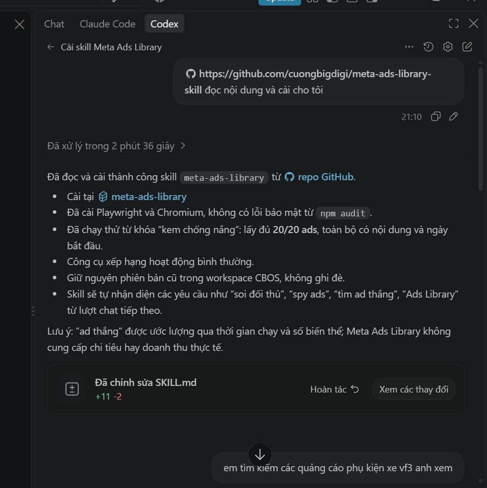
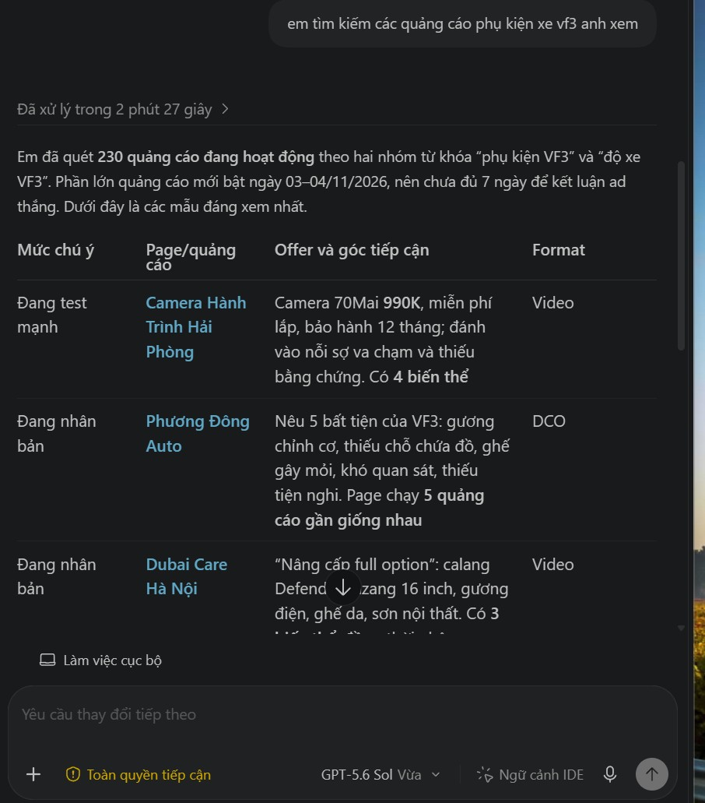
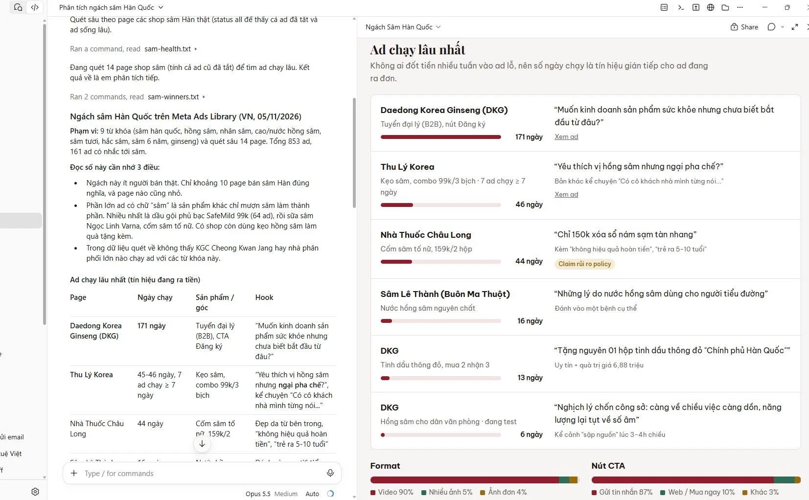
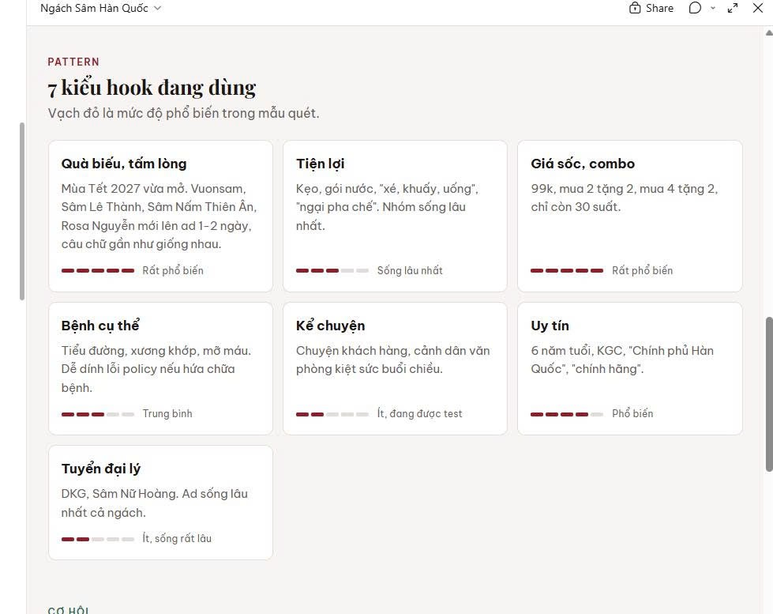
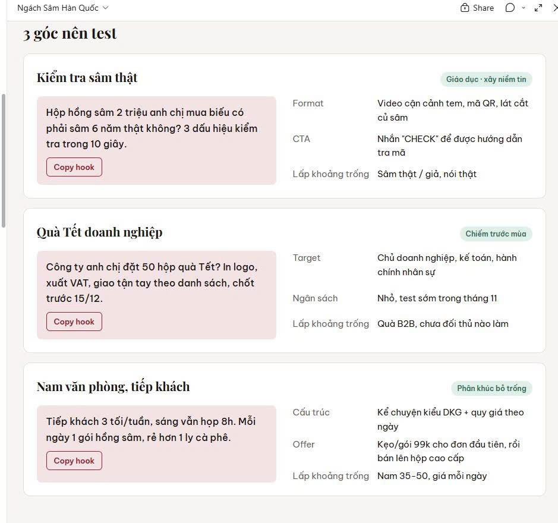
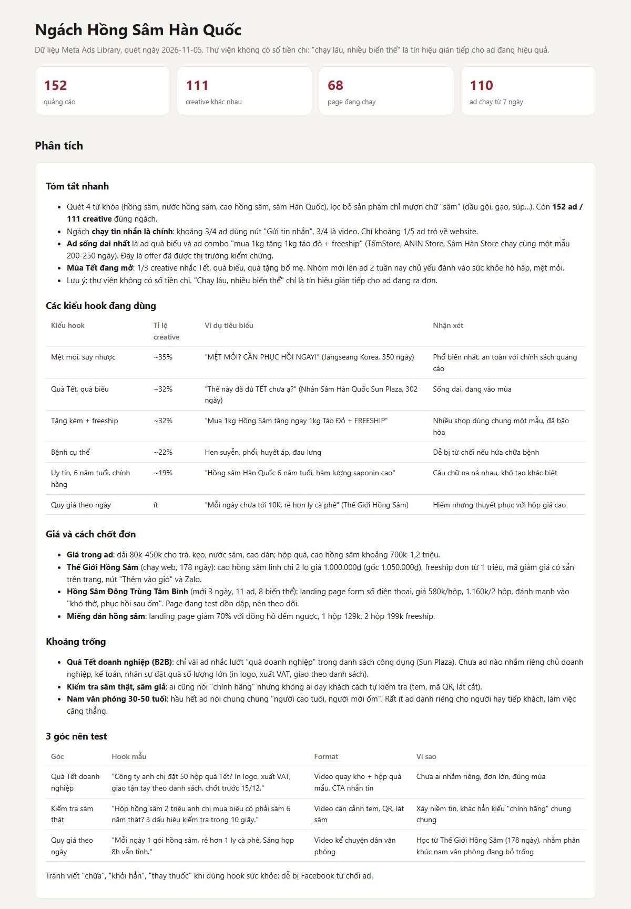
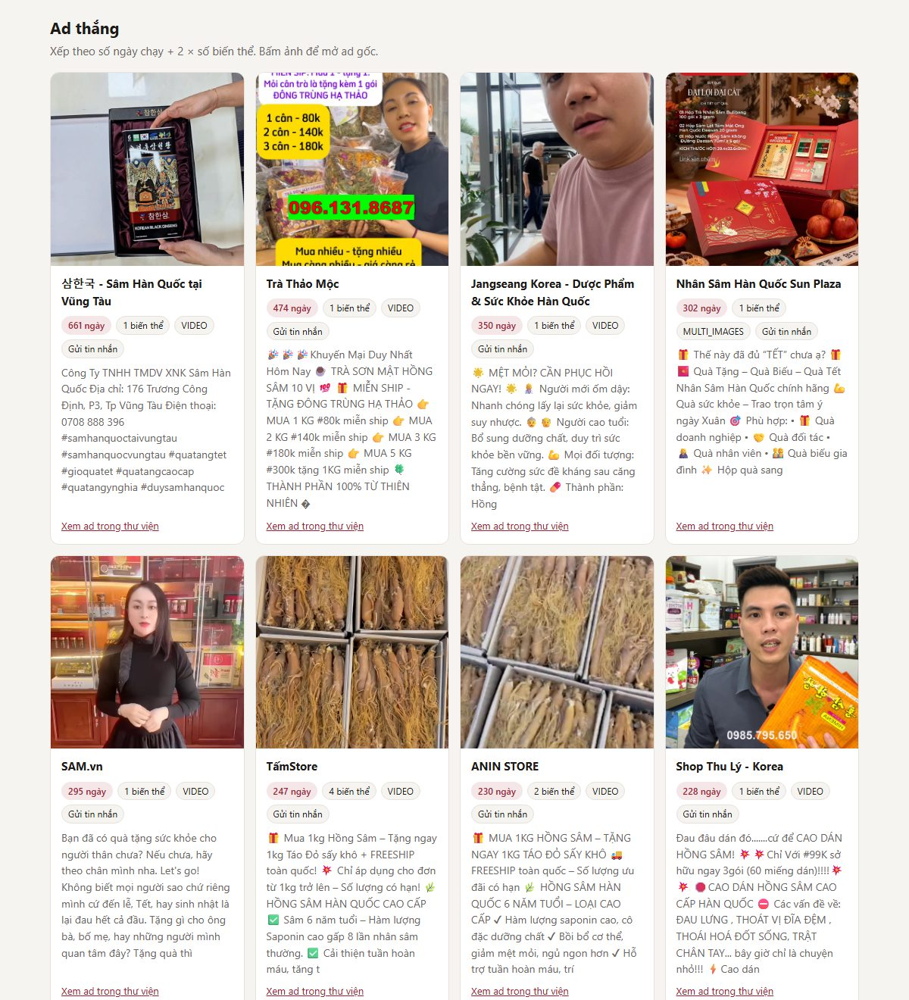
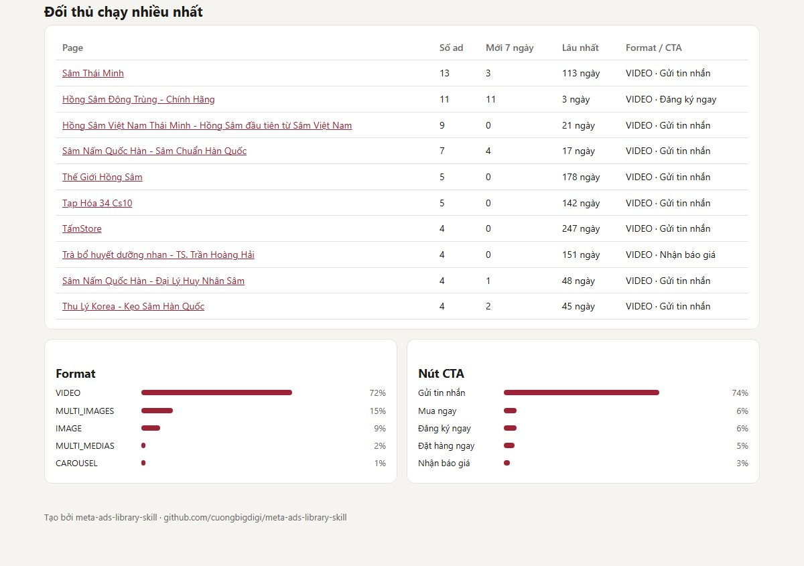

# Meta Ads Library Skill

**Skill cho Claude Code và Codex: soi quảng cáo đối thủ trên Meta Ads Library, xếp hạng ad thắng, phân tích hook, offer, CTA.**

Phiên bản 1.5.0, cập nhật 06/11/2026.

Bộ này giúp AI agent (Claude Code, Codex) tự lấy quảng cáo đối thủ trên thư viện quảng cáo của Meta, xếp hạng ad đang ra tiền và đối thủ mạnh nhất ngách, phân tích hook, offer, format, CTA, soi landing page, tải ảnh/video ad về máy, xuất báo cáo HTML và theo dõi đối thủ mỗi ngày. Không cần đăng nhập Facebook, không cần token.

👉 **Tham gia nhóm Zalo Ads AI lo - Tự động hóa quảng cáo: [zalo.me/g/37yoic8thaeho75yicnb](https://zalo.me/g/37yoic8thaeho75yicnb)** để hỏi đáp khi cài đặt, nhận bản cập nhật khi Facebook đổi cấu trúc và học thêm cách dùng AI chạy quảng cáo.

> *English: An agent skill for Claude Code and Codex that collects competitor ads from the Meta Ad Library via a headless browser (no login, no API token), ranks likely winners by run time and variant count, and analyzes hooks, offers and CTAs. The official Ad Library API only returns political ads outside the EU, so this works for commercial ads in any country. Docs are in Vietnamese.*

## Cần có
> ⚠️ **Skill chỉ chạy trên máy tính Windows, với Claude Code hoặc Codex** (Mac: liên hệ [nhóm Zalo](https://zalo.me/g/37yoic8thaeho75yicnb) để được hỗ trợ cài). Không dùng được trên claude.ai, ChatGPT bản web hay app điện thoại, vì skill cần mở trình duyệt và chạy code trên máy của bạn.

1. **Claude Code hoặc Codex cài trên máy tính.** Chưa cài thì xem video hướng dẫn (video của các bạn khác, mình sẽ quay bản riêng sau):
   - Cài Codex trên máy tính: [xem video](https://www.facebook.com/reel/1051710833986249)
   - Cài Claude Code: [xem video](https://www.youtube.com/watch?v=ON6H2YbnoVg)
2. Không cần cài gì thêm: bộ cài tự lo Node.js, thư viện và trình duyệt.

## Cài đặt trên Windows: bấm đúp 1 file (khoảng 5 phút)
1. Bấm nút xanh **Code > Download ZIP** ở đầu trang này.
2. Bấm chuột phải vào file ZIP vừa tải, chọn **Extract All / Giải nén tất cả**. Nên giải nén ra **Desktop** hoặc **Documents** (đừng mở thẳng trong file ZIP).
3. Mở thư mục vừa giải nén, **bấm đúp `cai-dat.bat`**.
   - Windows hiện "Windows protected your PC"? Bấm **More info / Thông tin thêm** rồi **Run anyway / Vẫn chạy**.
   - Windows hỏi quyền cài Node.js thì bấm **Yes**.
4. Chờ cửa sổ đen chạy hết 6 bước, thấy chữ xanh **CÀI ĐẶT HOÀN TẤT** là xong.

**Cài xong dùng thế nào?** Bộ cài tự mở trang hướng dẫn (`huong-dan.html`) và tạo 3 biểu tượng ngoài Desktop:
- **Huong dan Meta Ads Library**: mở lại hướng dẫn, có câu lệnh mẫu bấm Copy, từ dễ đến khai thác sâu.
- **Soi ads doi thu (Claude Code)** / **Soi ads doi thu (Codex)**: bấm đúp là mở agent, gõ yêu cầu vào ô chat.

Ba điều người mới hay nhầm:
1. **Không gõ từ khóa vào cửa sổ đen của bộ cài.** Từ khóa gõ vào **ô chat của Claude Code hoặc Codex**, bằng tiếng Việt bình thường, ví dụ: "Soi đối thủ ngành nến thơm, cho anh top 10 ad thắng".
2. **Đang mở Claude Code / Codex lúc cài thì tắt hẳn rồi mở lại** để agent nhận skill mới.
3. Agent **xin phép chạy lệnh** thì chọn Yes / Allow. Mỗi lần quét mất 1-3 phút.

Bộ cài tự làm hết:
- Cài Node.js nếu máy chưa có (hoặc bản quá cũ).
- Cài thư viện và tải trình duyệt Chromium (khoảng 150 MB, chỉ lần đầu), tự thử lại khi mạng chập chờn.
- Quét thử 3 quảng cáo để chắc chắn tool chạy được.
- Cài skill dùng chung cho **cả Claude Code và Codex**, mở agent ở thư mục nào cũng gọi được.
- Hỏi bạn có muốn mở Claude Code / Codex luôn không.

Sau khi cài: **đừng xóa hoặc đổi tên thư mục đã giải nén**, skill đang dùng nó. Lỡ chuyển chỗ thì bấm đúp `cai-dat.bat` lần nữa. Có bản mới thì tải ZIP mới về và chạy lại `cai-dat.bat`.

**Cài lỗi?** Màn hình sẽ ghi rõ "Cách sửa". Vẫn không được thì gửi file **`cai-dat.log`** (nằm trong thư mục đã giải nén) vào [nhóm Zalo](https://zalo.me/g/37yoic8thaeho75yicnb).

**Dùng Mac?** Bộ cài tự động hiện chỉ hỗ trợ Windows. Liên hệ [nhóm Zalo](https://zalo.me/g/37yoic8thaeho75yicnb) để được hỗ trợ cài trên Mac.

Cách cài khác: nhờ agent cài (dành cho người đã quen terminal)

1. Tải ZIP và giải nén, hoặc `git clone https://github.com/cuongbigdigi/meta-ads-library-skill.git`.
2. Mở terminal tại thư mục đó, khởi động agent (`claude` hoặc `codex`) rồi gõ:
   > Cài đặt dự án này: chạy npm install rồi chạy thử skill meta-ads-library với từ khóa "kem chống nắng", lấy 20 ad.
3. Thấy báo `OK 20 ads` là xong. Chưa được thì gõ `npm run doctor`.

### Cài bằng cách dán link cho agent
Đã có Codex hoặc Claude Code và không muốn tải ZIP? Dán link repo cho agent và nhờ cài:

> https://github.com/cuongbigdigi/meta-ads-library-skill đọc nội dung và cài cho tôi

Agent sẽ chép skill vào thư mục skill chung (`~/.codex/skills/` với Codex, `~/.claude/skills/` với Claude Code), clone toàn bộ repo vào thư mục `runtime/` cạnh skill, cài thư viện và chạy thử. Sau đó mở agent ở dự án nào cũng gọi được skill.

Hỏi thử ngay sau khi cài: "tìm các quảng cáo phụ kiện xe VF3":

## Cách dùng
Chỉ cần nói với agent bằng tiếng Việt. Không biết hỏi gì thì copy câu mẫu dưới đây, thay phần trong ngoặc vuông.

### Câu lệnh mẫu theo mục tiêu
| Muốn | Câu mẫu |
|---|---|
| Tìm ad đang ra tiền | "Soi ngách [nến thơm], cho anh top 10 ad chạy lâu nhất và phân tích hook, offer." |
| Biết đối thủ là ai | "Ngách [máy lọc nước] có những page nào chạy ads mạnh nhất? Xếp hạng giúp em." |
| Soi kỹ 1 đối thủ | "Quét toàn bộ quảng cáo của page [link hoặc ID page], kể cả ad đã tắt. Họ test gì, giữ gì?" |
| Lấy ý tưởng hook | "Gom các kiểu hook đang dùng trong ngách [mỹ phẩm thuần chay], mỗi kiểu 2 ví dụ." |
| So giá, so offer | "So sánh giá, combo, quà tặng của 5 đối thủ đứng đầu ngách [đồ ăn vặt], soi cả landing page." |
| Chuẩn bị mùa | "Ngách [hồng sâm] đang chạy gì cho Tết? Ad nào mới lên trong 2 tuần nay?" |
| Tìm khoảng trống | "Ngách [phụ kiện VF3] còn góc nào chưa ai khai thác? Đề xuất 3 góc test cho shop em: [sản phẩm, giá, khách hàng]." |
| Viết ads luôn | "Từ các ad thắng ngách [nến thơm], viết 10 hook và 2 kịch bản video 15 giây cho sản phẩm của em: [mô tả]." |
| Lưu creative | "Tải ảnh và video của top 10 ad về máy." |
| Báo cáo gửi khách | "Xuất báo cáo HTML có ảnh cho ngách [hồng sâm] để em gửi khách." |
| Theo dõi hằng ngày | "Theo dõi ngách [nến thơm] và 5 đối thủ mạnh nhất, quét mỗi sáng 8h." |

Mẹo để kết quả tốt hơn:
- **Nói rõ sản phẩm của bạn** (giá, bán cho ai, chốt qua tin nhắn hay web) thì góc test và hook sẽ sát hơn. Không nói thì agent sẽ hỏi.
- **Ngách có nhiều cách gọi** thì bảo agent quét vài từ khóa rồi gộp lại, ví dụ "quét cả phụ kiện VF3 và độ xe VF3 rồi xếp hạng chung".
- **Ngách mới** mà toàn ad vài ngày tuổi thì agent sẽ báo là ngách đang test thay vì gọi là ad thắng.

Agent sẽ tự chạy tool, đọc kết quả và trả về bảng phân tích. File dữ liệu gốc nằm trong thư mục `output/`.

### Ví dụ: soi ngách sâm Hàn Quốc với Claude Code (Opus 5.5)
Claude quét 9 từ khóa và 14 page shop sâm (853 ad), lọc ra ad chạy lâu nhất, gom các kiểu hook đang dùng và đề xuất 3 góc test, rồi trình bày thành trang báo cáo:

### Ví dụ: báo cáo HTML xuất bằng `report.js`
Câu lệnh: "Soi ngách hồng sâm Hàn Quốc, soi cả landing page, rồi xuất báo cáo HTML có ảnh cho anh." Agent quét 4 từ khóa, lọc còn 152 ad đúng ngách, soi 8 landing page, viết phần phân tích rồi xuất ra 1 trang HTML mở bằng trình duyệt nào cũng được:

> *Ghi chú: đây là ngách mình chọn ngẫu nhiên để test tool, không nhằm quảng bá hay đánh giá quảng cáo của bất kỳ page nào. Toàn bộ dữ liệu lấy từ Thư viện quảng cáo công khai của Meta.*

## Theo dõi ngành hàng và đối thủ định kỳ
Muốn máy tự quét mỗi sáng và báo khi đối thủ ra ad mới? Nói với agent:

> Theo dõi ngành nến thơm và 5 page đối thủ chạy nhiều ad nhất, quét mỗi ngày lúc 8h sáng, gửi báo cáo về Discord webhook này: [dán link]

Agent sẽ tạo file `watchlist.json` (danh sách từ khóa + page đối thủ), chạy thử rồi hẹn giờ trên máy (Task Scheduler với Windows, cron với Mac). Mỗi lần quét, tool so với lần trước và báo:
- **Ad mới** đối thủ vừa lên.
- **Ad vừa sống qua mốc 7/14/30 ngày**: ứng viên ad thắng, nên xem kỹ.
- **Ad đối thủ đã tắt**: thường là ad không hiệu quả.

- **Xu hướng số ad** của từng đối thủ qua các lần quét: tăng mạnh nghĩa là họ đang đẩy ngân sách.

Báo cáo nằm ở `output/watch/latest.md`, gửi Discord hoặc Telegram nếu có cấu hình. Hỏi agent "đối thủ có gì mới?" là nó đọc báo cáo và phân tích.

Tự chạy tay: copy `watchlist.example.json` thành `watchlist.json`, sửa từ khóa/page, rồi gõ `npm run watch`.

Lưu ý: máy tính phải đang bật lúc đến giờ quét. Nên theo dõi dưới khoảng 20 mục, quét 1-2 lần mỗi ngày là đủ, quét dồn dập dễ bị Facebook chặn.

## Trong bộ này có gì
| File | Dùng để |
|---|---|
| `tools/ad-library/scrape.js` | Mở thư viện quảng cáo, lấy dữ liệu ad |
| `tools/ad-library/rank.js` | Xếp hạng ad thắng (chạy lâu, nhiều biến thể) |
| `tools/ad-library/pages.js` | Xếp hạng đối thủ trong ngách (số ad, ad mới, ad sống lâu) |
| `tools/ad-library/report.js` | Xuất báo cáo HTML có ảnh, mở bằng trình duyệt |
| `tools/ad-library/download.js` | Tải ảnh/video của top ad về máy |
| `tools/ad-library/lp.js` | Soi landing page: giá, ưu đãi, cách chốt đơn |
| `tools/ad-library/watch.js` | Theo dõi định kỳ: so với lần quét trước, báo ad mới / qua mốc ngày / đã tắt / xu hướng |
| `tools/ad-library/doctor.js` | Kiểm tra máy (`npm run doctor`) khi cài lỗi |
| `cai-dat.bat` + `tools/install/cai-dat.ps1` | Bộ cài 1 click cho Windows |
| `huong-dan.html` | Trang hướng dẫn sau khi cài: dùng ở đâu, câu lệnh mẫu bấm Copy |
| `watchlist.example.json` | Mẫu danh sách từ khóa + page đối thủ cần theo dõi |
| `.claude/skills/meta-ads-library/SKILL.md` | Skill cho Claude Code: khi nào dùng, quy trình, cách phân tích |
| `AGENTS.md` | Để Codex biết skill này |
| `package.json` | Danh sách thư viện cần cài |

Thư mục `.claude` có thể bị ẩn trên Windows/Mac. Không sao, agent vẫn thấy.

## Câu hỏi thường gặp
**Có mất phí không?** Skill miễn phí. Bạn chỉ trả phí gói Claude hoặc ChatGPT/Codex mà bạn đang dùng.

**Có bị khóa nick Facebook không?** Không. Tool mở thư viện quảng cáo công khai như khách vãng lai, không đăng nhập, không dùng tài khoản của bạn.

**Có dùng trên điện thoại hoặc claude.ai, ChatGPT bản web được không?** Không. Skill cần chạy trên máy tính với Claude Code hoặc Codex.

**Dùng Mac được không?** Tool chạy được trên Mac nhưng bộ cài 1 click chỉ có cho Windows. Liên hệ nhóm Zalo để được hỗ trợ cài.

**Sao không thấy số tiền đối thủ chi?** Meta không công khai chi tiêu của quảng cáo bán hàng. Tool dùng số ngày chạy và số biến thể làm tín hiệu thay thế: ad chạy càng lâu, nhân bản càng nhiều thì càng có khả năng đang ra tiền.

**Sao ra ít ad, hoặc ra ad không liên quan?** Từ khóa được tìm đúng cụm từ, nên cụm quá hẹp sẽ ra ít. Thử cách gọi khác mà người bán hay viết trong ad (ví dụ "hồng sâm" thay vì "nhân sâm Panax"). Nếu lẫn ad lạc đề, bảo agent "chỉ giữ ad liên quan đến [ngành]".

**Theo dõi định kỳ có chạy khi tắt máy không?** Không. Máy phải đang bật lúc đến giờ quét. Lần quét sau sẽ so với lần gần nhất nên không mất dữ liệu.

**Dùng cho thị trường nước ngoài được không?** Được. Bảo agent "quét thị trường Thái Lan / Mỹ..." (tham số `--country TH`, `US`...).

## Khi gặp lỗi
Cách nhanh nhất trên Windows: bấm đúp lại `cai-dat.bat`, nó tự sửa phần lớn lỗi cài đặt. Hoặc gõ `npm run doctor` (hoặc nhờ agent chạy). Lệnh này kiểm tra Node, thư viện, trình duyệt, quét thử 3 ad và chỉ cách sửa từng lỗi. Chụp màn hình kết quả gửi vào nhóm Zalo nếu vẫn không được.

Hoặc mô tả lỗi cho agent và nhờ nó sửa. Một số câu mẫu:

- **Ra 0 ad:** "Tool ra 0 ad. Chạy lại với --headed xem trang có hiện quảng cáo không. Nếu có thì bắt lại dữ liệu mạng /api/graphql, xem cấu trúc đổi thế nào rồi sửa scrape.js."
- **Kết quả lẫn ad không liên quan:** "Xếp hạng lại, chỉ giữ ad liên quan đến [ngành của bạn]."
- **Cần lưu ảnh/video quảng cáo:** "Tải ảnh và video của top 10 ad về thư mục creative/." Link ảnh/video sẽ hết hạn sau vài ngày nên cần tải ngay.
- **Lỗi khi cài:** "npm install bị lỗi này: [dán lỗi]. Sửa giúp tôi."

Nhờ agent mà vẫn chưa xong? Hỏi trực tiếp trong [nhóm Zalo Ads AI lo](https://zalo.me/g/37yoic8thaeho75yicnb).

## Lưu ý
- Thư viện quảng cáo **không cho biết chi tiêu hay doanh thu**. "Chạy lâu, nhiều biến thể" chỉ là tín hiệu gián tiếp cho thấy ad đang hiệu quả.
- **Không sao chép nguyên văn** quảng cáo của người khác. Hãy lấy cấu trúc và góc tiếp cận, rồi viết lại theo sản phẩm của bạn.
- Đây là công cụ nghiên cứu. Việc tự động lấy dữ liệu có thể không phù hợp với điều khoản sử dụng của Meta. Hãy dùng vừa phải, không chạy dồn dập. Người dùng tự chịu trách nhiệm khi sử dụng.
- Facebook thỉnh thoảng đổi cấu trúc trang. Khi tool hỏng, làm theo mục "Khi gặp lỗi", hoặc chờ bản cập nhật mới.

## Nhóm Zalo
Skill này được chia sẻ miễn phí từ nhóm **Ads AI lo - Tự động hóa quảng cáo**. Vào nhóm để:
- Hỏi đáp khi cài đặt hoặc gặp lỗi
- Nhận thông báo khi có bản cập nhật
- Chia sẻ kết quả soi đối thủ và cách dùng AI agent chạy quảng cáo

👉 [zalo.me/g/37yoic8thaeho75yicnb](https://zalo.me/g/37yoic8thaeho75yicnb)

## Thay đổi
- **1.5.0 (06/11/2026)**: cài xong tự mở trang hướng dẫn `huong-dan.html` (gõ ở đâu, có cần mở lại agent không, câu lệnh mẫu 5 cấp bấm Copy, mẹo chọn từ khóa, lỗi thường gặp); tạo biểu tượng Desktop mở hướng dẫn và mở Claude Code/Codex; skill biết trả lời khi khách hỏi "dùng thế nào".
- **1.4.0 (05/11/2026)**: bộ cài 1 click cho Windows (`cai-dat.bat`): tự cài Node.js, thư viện, Chromium, quét thử, cài skill dùng chung cho Claude Code và Codex, ghi log `cai-dat.log` để gửi hỗ trợ. Mac liên hệ nhóm Zalo.
- **1.3.0 (05/11/2026)**:
  - Sửa lỗi quan trọng: tìm theo từ khóa giờ **khớp đúng cụm từ** (trước đây khớp lỏng, ra nhiều ad lạc đề) và **ưu tiên ad nhiều hiển thị** (trước đây ra toàn ad mới 1 ngày nên khó thấy ad thắng). Thêm `--sort new` và `--loose` khi cần kiểu cũ.
  - Tool mới: `pages.js` xếp hạng đối thủ, `report.js` báo cáo HTML có ảnh, `download.js` tải creative, `lp.js` soi landing page, `doctor.js` kiểm tra máy.
  - Theo dõi định kỳ: thêm xu hướng số ad và gửi Telegram.
  - Skill hỏi thông tin sản phẩm trước khi đề xuất góc test, biết viết hook/kịch bản từ insight, gợi ý bước tiếp theo.
  - README: câu lệnh mẫu theo mục tiêu, câu hỏi thường gặp.
- **1.2.0 (05/11/2026)**: thêm `watch.js` theo dõi ngành hàng + đối thủ định kỳ (ad mới, ad qua mốc 7/14/30 ngày, ad đã tắt), hẹn giờ trên máy, gửi Discord.
- **1.1.0 (05/11/2026)**: skill tự tìm thư mục chạy khi cài dùng chung (Codex/Claude Code); `rank.js` gộp được nhiều file từ khóa, thêm `--test-variants` và hướng dẫn xử lý ngách mới toàn ad đang test.
- **1.0.0 (04/11/2026)**: bản đầu tiên.

## Giấy phép
MIT. Dùng, sửa, chia sẻ tự do. Xem file `LICENSE`.
